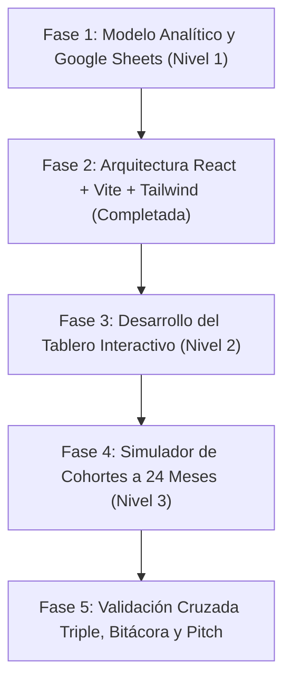

# Plan de Desarrollo — Caso A: Tueste

**Proyecto**: Caso A — Tueste (Unit Economics & Financial Modeling)  
**Stack Tecnológico**: React + Vite + JavaScript (.jsx) + Tailwind CSS + Python 3 (motor de validación) + Google Sheets  
**Estado Actual**: Datos 100% verificados contra el PDF oficial. Arquitectura React + Vite + Tailwind compilada. Listo para autorizar desarrollo del modelo en Google Sheets (Nivel 1).

---

## Fases de Implementación

---

### Fase 1: Modelo Analítico y Google Sheets (Nivel 1)
**Objetivo**: Construir el modelo financiero base y la recomendación ejecutiva para Diego.

1. **Consolidación de Parámetros Oficiales**:
   - Integración de los datos oficiales: Ticket $34, Café $10,88 ($5,44/bolsa), Envío $4,50, Pasarela 4,5% ($1,53), Empaque $1,20 -> CM2 $15,89 (46,74%), ROAS break-even 2,14x.
   - Pedido con 30% descuento: $23,80 -> CM2 $6,15 (25,84%), ROAS break-even 3,87x.
   - Validación con script de la skill `unit_econ.py`.
2. **Diseño de la Calculadora en Google Sheets**:
   - Pestaña **"Supuestos"**: Celdas editables diferenciadas con formato visual (fondo coloreado).
   - Pestaña **"Resultados"**: Automatización 100% mediante fórmulas dinámicas.
   - Cálculo de los 3 escenarios lado a lado:
     - Escenario 1: *Hoy* ($8.000 Meta, 165 clientes, CAC real $54,55, ROAS real 0,70x).
     - Escenario 2: *Agencia* ($16.000 Meta + 30% desc, 235 clientes, CAC real $72,34, ROAS real 0,35x).
     - Escenario 3: *Propuesta Equipo* (2 cambios estratégicos: ej. Pack de 3 bolsas $48 con envío gratis desde $45 y optimización de agencia).
3. **Curva de Caja (Mes 0 al 12)**:
   - Modelado de caja acumulada para los 3 escenarios con línea de corte en cero.
4. **Verificación a Mano y Detección de la Trampa**:
   - Fila calculada a mano con fórmula aritmética explícita en la hoja.
   - Redacción de la recomendación ejecutiva de 1 página: Decisión explícita (escalar, arreglar o pausar) sustentada en la trampa del ROAS de retargeting vs ROAS de adquisición real.
   - Redacción de la sección «En qué se equivocó o nos confundió la IA».

---

### Fase 2: Configuración del Entorno Frontend (React + Vite + Tailwind CSS) — [COMPLETADA]
**Objetivo**: Preparar la base tecnológica del proyecto web sin comprometer archivos existentes.

1. **Scaffolding y Preservación**:
   - React 18, Vite 6, Tailwind CSS v3, PostCSS, Autoprefixer y Lucide React configurados.
   - Archivos originales y skill intactos.
2. **Compilación Verificada**:
   - `vite build` ejecutado exitosamente con 0 errores (bundle generado en `dist/`).

---

### Fase 3: Tablero Interactivo de Tueste (Nivel 2)
**Objetivo**: Construir el dashboard reactivo con visualización en tiempo real de métricas y la trampa del caso.

1. **Panel de Parámetros Dinámicos**:
   - Controles interactivos (sliders / inputs numéricos) para los 9 parámetros del caso.
2. **KPI Cards en Tiempo Real**:
   - Los 6 números fundamentales: CM2, ROAS break-even, CAC real, LTV, LTV:CAC, Payback.
   - ROAS real del 1er pedido y CAC marginal del tramo.
   - Semáforo condicional de LTV:CAC (Rojo <1x, Amarillo 1–2.9x, Verde ≥3x).
3. **Visualizaciones Gráficas Obligatorias**:
   - Gráfico 1: Curva de caja de un cliente mes 0–12 con punto de payback.
   - Gráfico 2: LTV frente a CAC con directrices 1:1 y 3:1.
   - Gráfico 3: Clientes nuevos según inversión y CAC marginal por tramo.
   - **Gráfico 4 (El Gráfico de la Trampa)**: Comparativa directa entre ROAS de Ads Manager (3,0x), ROAS real del primer pedido (0,70x) y ROAS de break-even (2,14x / 3,87x).
4. **Validación y Reseteo**:
   - Botón para restablecer valores originales.
   - Coincidencia numérica con Google Sheets (< 1% discrepancia).

---

### Fase 4: Simulador de Cohortes a 24 Meses (Nivel 3)
**Objetivo**: Desarrollar el simulador dinámico plurianual con control de liquidez y reglas oficiales del PDF.

1. **Motor de Interpolación de Clientes**:
   - Interpolación lineal entre los tramos históricos ($0 a $20.000) pasando por $(0, 0)$.
   - Suma mensual incondicional de 47 clientes orgánicos.
2. **Matriz de Cohortes a 24 Meses**:
   - Seguimiento mensual de cohortes: 85% sueltos (meses 1-12 según tabla de retención, meses 13-24 a 0,10 pedidos/mes); 15% suscriptores (retención 91% mensual).
   - Contribución de base instalada: $9.000 iniciales decayendo al 3% mensual ($\times 0,97^{t-1}$).
   - Salidas mensuales: Inversión Meta + Fee agencia ($1.000 si inversión > 0) + Costos fijos ($6.500).
   - Caja acumulada iniciando en $35.000.
3. **Reglas del Juego Oficiales**:
   - **Piso de Caja**: Alerta inmediata y penalización si la caja cae por debajo de **$5.000 USD**.
   - **Continuidad post-mes 12**: Desde el mes 13, la inversión mensual $\ge$ promedio de meses 1 a 12.
   - **Revisión del Mes 1**: Cálculo a mano del Mes 1 con $8.000 fijos contrastado con la hoja.
4. **Comparativa de 4 Planes**:
   - Plan 1 ($8.000 fijos), Plan 2 ($16.000 fijos agencia), Plan Propio 1 y Plan Propio 2.
   - Evaluación: Caja mínima (mes), Caja mes 24, Suscriptores activos mes 24.
   - Pitch de 2 minutos para el tío de Diego: presupuesto propuesto, análisis de riesgo y condiciones para incrementarlo.
   - Modelado del plan óptimo de inversión para el pitch de defensa.

---

### Fase 5: Validación Cruzada, Bitácora y Entrega
**Objetivo**: Asegurar coherencia total y preparar la presentación final.

1. **Validación Cruzada Triple**:
   - Verificación de consistencia: `Google Sheets (Nivel 1) == Tablero React (Nivel 2) == Script Python (Skill)`.
2. **Cierre de Bitácora**:
   - Documentación completa de pruebas, errores de la IA detectados, desviaciones corregidas y lecciones aprendidas.
3. **Preparación del Pitch de 3 Minutos**:
   - Estructuración de la decisión: *Escalar, Arreglar o Pausar*.
   - Presentación de los dos cambios operativos y su impacto cuantitativo.
